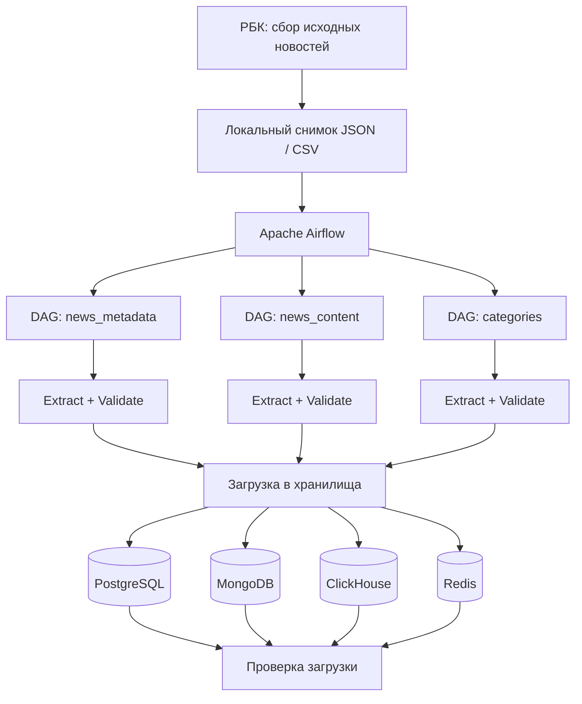

# Лабораторная работа № 1. Apache Airflow: ETL-процесс и слой ODS

**Тема:** оркестрация ETL-процессов с помощью Apache Airflow и сравнительный анализ хранилищ данных.  
**Источник данных:** новости РБК.  
**Стек:** Docker Compose, Apache Airflow 3.1.7, Python, PostgreSQL, MongoDB, ClickHouse, Redis.

## 1. Цель и постановка задачи

Цель работы — развернуть Apache Airflow в Docker, реализовать не менее трёх независимых ETL-процессов для загрузки сырых данных в слой ODS, организовать хранение данных в нескольких СУБД и обосновать выбор наиболее подходящего хранилища на основании измерений.

В ходе работы необходимо:

1. Развернуть Airflow и хранилища с помощью Docker Compose.
2. Реализовать минимум три DAG для разных логических наборов данных.
3. Загрузить данные в PostgreSQL, MongoDB и ClickHouse (дополнительно — Redis).
4. Проверить результаты загрузки.
5. Провести сравнительный анализ и сформулировать выводы.

## 2. Источник данных и состав наборов

В качестве единого источника используются публикации **[РБК](https://www.rbc.ru/short_news)**. Для воспроизводимости ETL-процессы читают локально сохранённый снимок новостей:

- `data/rbc_news.json` — структурированные записи новостей, включая содержание;
- `data/rbc_news.csv` — табличное представление метаданных.

Исходный сбор новостей реализован отдельно в `parser.py` (Selenium и BeautifulSoup). **Важно:** текущие DAG не запускают парсер при каждом выполнении; стадия `Extract` читает подготовленные JSON/CSV. Это позволяет повторять загрузку без зависимости от доступности сайта, но не является непрерывным онлайн-сбором.

Данные разделены на три логических набора:

| Набор | DAG | Назначение | Источник для Extract |
|---|---|---|---|
| Метаданные | `rbc_ods_news_metadata` | Заголовок, URL, категория, даты и статус обработки | CSV |
| Содержимое новостей | `rbc_ods_news_content` | Записи публикаций с содержанием и сопутствующими полями | JSON |
| Категории | `rbc_ods_categories` | Уникальные категории публикаций | CSV |

Для снимка метаданных проверено **475 записей** и **32 категории**.

## 3. Архитектура системы



Airflow управляет зависимостями задач, запуском, повторными попытками и журналами выполнения. Слой ODS сохраняет исходные данные с минимальной трансформацией, необходимой для унификации структуры и загрузки.

### 3.1. Хранилища

| Хранилище | Модель | Роль в эксперименте |
|---|---|---|
| **PostgreSQL** | Реляционная БД, `JSONB` | Универсальное ODS-хранилище с SQL и ограничениями целостности |
| **MongoDB** | Документная БД | Хранение полуструктурированных новостных документов |
| **ClickHouse** | Колоночная аналитическая СУБД | Аналитические запросы и агрегации |
| Redis (дополнительно) | Key-value | Оперативный доступ к данным; не входит в основное сравнение трёх СУБД |

PostgreSQL, MongoDB и ClickHouse — три основные сравниваемые системы. Redis используется дополнительно.

## 4. Структура проекта

```text
lab1/
├── docker-compose.yaml
├── Dockerfile
├── docker-requirements.txt
├── parser.py
├── dags/
│   ├── rbc_news_metadata.py
│   ├── rbc_news_content.py
│   └── rbc_categories.py
├── data/
│   ├── rbc_news.json
│   └── rbc_news.csv
├── src/rbc_pipeline/
│   ├── __init__.py
│   ├── airflow_dag.py
│   ├── config.py
│   ├── extract.py
│   └── storages.py
├── scripts/
│   └── benchmark.py
└── reports/
    ├── benchmark_results.csv
    ├── insert_475.svg
    ├── insert_5000.svg
    ├── filter_475.svg
    ├── filter_5000.svg
    ├── aggregate_475.svg
    └── aggregate_5000.svg
```

## 5. Развёртывание

**Требования:** установленный Docker с поддержкой Compose, свободные локальные порты сервисов, достаточный объём оперативной памяти для одновременного запуска Airflow и СУБД.

Из каталога `lab1`:

```bash
docker compose build
docker compose up -d
docker compose ps
```

Веб-интерфейс Airflow: **http://localhost:8080**. В используемой учебной конфигурации учётные данные Airflow: `airflow` / `airflow`.

Для просмотра журналов:

```bash
docker compose logs -f airflow-scheduler
```

> Учётные данные и открытые локальные порты приведены только для учебной среды. Для промышленного развёртывания необходимы секреты, разграничение прав и настройка сетевого доступа.

## 6. Реализация ETL-процессов

Каждый DAG создаётся через фабрику `create_dag(...)` в `src/rbc_pipeline/airflow_dag.py` и содержит задачи:

1. `extract_and_validate` — чтение файла и проверка структуры записей;
2. `load_postgres` — загрузка в PostgreSQL;
3. `load_clickhouse` — загрузка в ClickHouse;
4. `load_mongodb` — загрузка в MongoDB;
5. `load_redis` — загрузка в Redis;
6. `verify_all` — проверка результатов загрузки.

После `extract_and_validate` загрузчики выполняются независимо, затем запускается `verify_all`.

**Особенности реализации:**

- **PostgreSQL:** таблицы `ods.raw_<dataset>`, идентификатор `row_id`, полезная нагрузка `payload JSONB`, загрузка с `ON CONFLICT DO UPDATE`.
- **MongoDB:** коллекции `ods.raw_<dataset>`, идентификатор документа `_id`, обновление существующих записей по ключу.
- **ClickHouse:** таблицы `ods.raw_<dataset>` на `ReplacingMergeTree(version)`; повторные вставки могут временно создавать физические дубликаты. Для подсчёта актуального логического количества записей используется `FINAL`.
- **Redis:** хранение записей в ключах и наборах для быстрого доступа.

### 6.1. Результаты выполнения

Все три DAG были запущены в Airflow, задачи загрузки и проверки завершились успешно. Для набора `news_metadata` количество записей проверено непосредственно в хранилищах:

| СУБД | Логическое количество записей |
|---|---:|
| PostgreSQL | 475 |
| MongoDB | 475 |
| ClickHouse (`FINAL`) | 475 |

В ClickHouse обычный `count()` после повторных загрузок показывал 950 физических строк, а запрос с `FINAL` — 475 логических записей. Это ожидаемое поведение выбранного движка до слияния частей.

Примеры команд проверки (из каталога `lab1`):

```bash
# PostgreSQL
docker compose exec postgres-ods psql -U etl_user -d ods \
  -c 'SELECT COUNT(*) FROM ods.raw_news_metadata;'

# MongoDB
docker compose exec mongodb mongosh -u etl_user -p etl_password \
  --authenticationDatabase admin --quiet \
  --eval 'db.getSiblingDB("ods").raw_news_metadata.countDocuments({})'

# ClickHouse
docker compose exec clickhouse clickhouse-client \
  --user etl_user --password etl_password \
  --query 'SELECT count() FROM ods.raw_news_metadata FINAL'
```

## 7. Сравнительный анализ хранилищ

### 7.1. Методика

Для сравнения использован `scripts/benchmark.py`, который выполняет операции через Python-клиенты трёх СУБД. Тестовые данные формируются из снимка РБК: исходные записи циклически повторяются с новыми `row_id`, чтобы получить одинаковые по объёму наборы **475** и **5 000** строк. Таким образом, 5 000 строк — **синтетически увеличенная выборка**, а не 5 000 уникальных публикаций.

Измеряются три операции:

- **Insert:** подготовка таблицы/коллекции и пакетная вставка;
- **Filter:** подсчёт новостей категории «Политика»;
- **Aggregate:** группировка по категориям и сортировка по количеству.

Для каждой операции выполнено **5 повторений**. В таблицах приводится **медиана клиентского времени** в миллисекундах (`time.perf_counter`). Для чтения выполняется предварительный прогрев.

**Ограничения измерений:**

1. В тесте `insert` замер включает удаление и создание таблицы/коллекции, поэтому сравнивается **время подготовки и загрузки**, а не изолированная скорость вставки.
2. Запросы выполняются в локальной Docker-среде на одном компьютере. Результаты зависят от ресурсов, прогрева, драйверов и конфигурации.
3. Для фильтрации не создаются специальные вторичные индексы; результаты отражают конфигурацию тестовых таблиц.
4. Объёмы 475 и 5 000 строк невелики для оценки потенциала ClickHouse на больших данных.
5. Тестовые таблицы используют собственную схему и создаются отдельно от рабочих ODS-таблиц.

### 7.2. Результаты: 475 записей

| Операция, мс | PostgreSQL | MongoDB | ClickHouse |
|---|---:|---:|---:|
| Подготовка и вставка | 78.388 | **13.237** | 32.464 |
| Фильтрация | **0.051** | 0.176 | 0.950 |
| Агрегация | **0.074** | 0.255 | 0.983 |


### 7.3. Результаты: 5 000 записей

| Операция, мс | PostgreSQL | MongoDB | ClickHouse |
|---|---:|---:|---:|
| Подготовка и вставка | 824.310 | **125.356** | 216.761 |
| Фильтрация | **0.260** | 1.440 | 1.236 |
| Агрегация | **0.479** | 2.533 | 1.128 |


Исходные результаты доступны в [`reports/benchmark_results.csv`](reports/benchmark_results.csv).

### 7.4. Интерпретация

- **MongoDB** показала наименьшее время полного цикла подготовки и загрузки: 125.356 мс для 5 000 записей против 824.310 мс у PostgreSQL. Этот результат нельзя трактовать как чистое преимущество скорости вставки из-за включённого пересоздания таблиц.
- **PostgreSQL** показала минимальное время фильтрации и агрегации для обоих размеров тестовой выборки.
- **ClickHouse** на 5 000 строк выполнила агрегацию за 1.128 мс, быстрее MongoDB (2.533 мс), но медленнее PostgreSQL (0.479 мс). На таких объёмах её возможности как аналитической СУБД раскрываются не полностью.

## 8. Выбор хранилища для ODS

**В качестве основного ODS-хранилища для текущего проекта выбран PostgreSQL.**

Причины выбора:

1. Удобная работа со структурированными метаданными новостей и возможность хранить исходные документы в `JSONB`.
2. Поддержка SQL, транзакций, ограничений целостности и обновления записей по ключу.
3. Лучшие результаты фильтрации и группировки в проведённом локальном эксперименте.
4. Простота проверки корректности данных и интеграции с последующими этапами обработки.

MongoDB остаётся разумной альтернативой при преимущественно документной модели данных и часто меняющейся схеме. ClickHouse целесообразно использовать в качестве отдельного аналитического слоя при росте объёмов и усложнении агрегирующих запросов. Redis подходит для кэширования, но не заменяет основное долговременное ODS-хранилище в данной архитектуре.

## 9. Воспроизведение бенчмарка

Убедиться, что контейнеры запущены:

```bash
docker compose ps
```

Если каталоги `scripts` и `reports` смонтированы в контейнер Airflow по путям `/opt/airflow/scripts` и `/opt/airflow/reports`, запустить:

```bash
docker compose exec -T airflow-scheduler \
  python /opt/airflow/scripts/benchmark.py
```

Скрипт сохраняет CSV и шесть SVG-графиков в `reports/`. При отсутствии указанных bind-mount каталогов необходимо добавить их в `volumes` соответствующего сервиса Airflow и пересоздать контейнер.

> Бенчмарк удаляет и пересоздаёт **только** тестовые объекты `benchmark_news`. Рабочие таблицы `ods.raw_*` не затрагиваются.

## 10. Демонстрация на защите

1. Выполнить `docker compose ps` и показать запущенные сервисы.
2. Открыть **http://localhost:8080** и показать три DAG: `rbc_ods_news_metadata`, `rbc_ods_news_content`, `rbc_ods_categories`.
3. Открыть успешный DAG Run, продемонстрировать граф задач и логи `extract_and_validate`, загрузчиков и `verify_all`.
4. Выполнить приведённые выше запросы к PostgreSQL, MongoDB и ClickHouse и показать совпадение количества записей.
5. Открыть графики из `reports/` и объяснить методику, результаты и ограничения измерений.
6. Обосновать выбор PostgreSQL как основного ODS-хранилища.

## 11. Выводы

В ходе лабораторной работы развёрнут Apache Airflow в Docker Compose, реализованы три ETL-процесса для логически различных наборов данных РБК и организована загрузка в PostgreSQL, MongoDB, ClickHouse и Redis. Успешность выполнения DAG подтверждена в интерфейсе Airflow, а согласованность данных для набора метаданных — проверкой количества записей в трёх основных СУБД.

Проведён воспроизводимый локальный эксперимент на 475 и 5 000 строках с измерением времени подготовки и вставки, фильтрации и агрегации. По совокупности функциональных требований и полученных результатов основным ODS-хранилищем выбран PostgreSQL. При дальнейшем развитии проекта целесообразно интегрировать онлайн-парсинг непосредственно в DAG и расширить нагрузочные испытания на большие объёмы данных.

## 12. Использованные источники

1. [Apache Airflow — Docker Compose](https://airflow.apache.org/docs/apache-airflow/stable/howto/docker-compose/index.html).
2. [Apache Airflow — документация](https://airflow.apache.org/docs/).
3. [PostgreSQL — документация](https://www.postgresql.org/docs/).
4. [MongoDB — документация](https://www.mongodb.com/docs/).
5. [ClickHouse — документация](https://clickhouse.com/docs).
6. [Redis — документация](https://redis.io/docs/latest/).
7. [РБК — лента новостей](https://www.rbc.ru/short_news).
